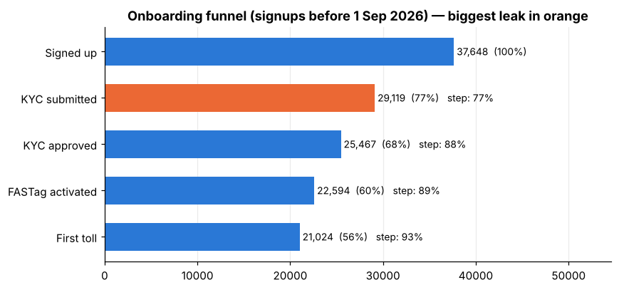
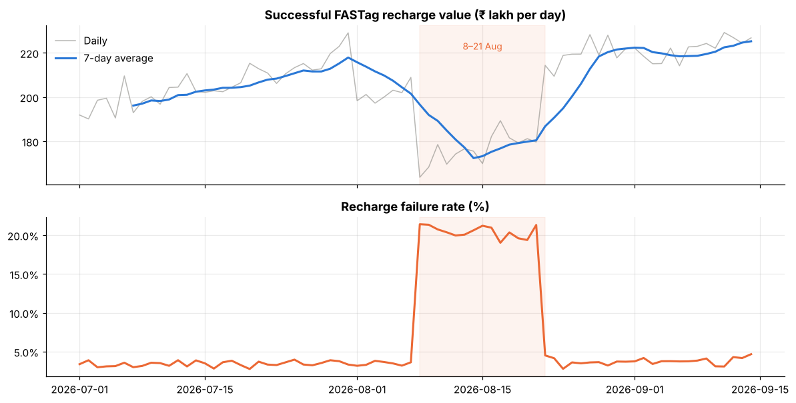
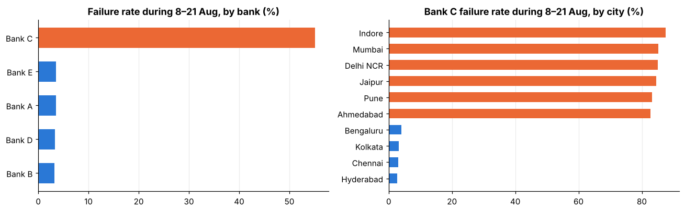
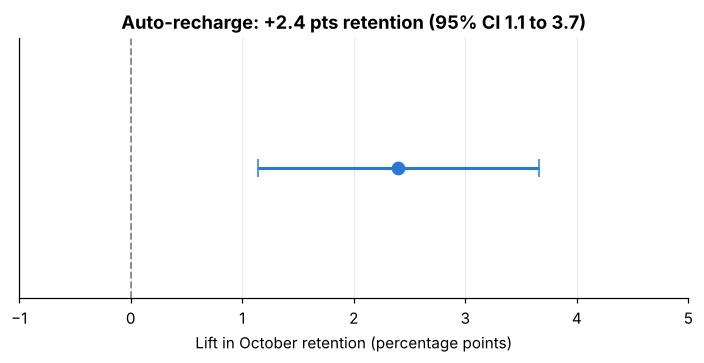

# Truck Operator Super-App — Product Analytics

End-to-end product analytics for a truck-operator super-app (FASTag tolling, fuel payments, GPS telematics and a freight-load marketplace, modelled on Indian truck-operator platforms): **activation funnel, cohort retention, cross-sell value, a root-cause analysis of a payments incident, and an A/B test readout.**

**Tools:** SQL (SQLite) · Python (pandas, SciPy, matplotlib, seaborn) · Excel (formula-driven KPI workbook) · Power BI

> **Data note:** the dataset is **simulated** (`scripts/01_generate_data.py`, fixed random seed). It is synthetic but designed to behave like a real platform, with monsoon seasonality, a bank outage, cross-sell effects and an experiment, so the analysis questions mirror real product-analyst work. Revenue uses assumed take rates (toll 0.4%, fuel 0.6%, ₹300 per GPS device per month, ₹150 per load).

---

## Business questions
1. **Activation:** where do new operators drop out of onboarding, and who drops most?
2. **Retention:** how well are operators retained, and what predicts staying?
3. **Cross-sell:** how much is a second service worth?
4. **Root cause:** why did successful FASTag recharges fall in mid-August 2026?
5. **Experiment:** should auto-recharge launch to everyone?

## Dataset (simulated)
| Table | Rows | Grain |
|---|---|---|
| `operators` | 40,000 | Truck operator: signup, city, fleet size, acquisition channel, bank |
| `onboarding_events` | 144,306 | Operator × stage (signup → KYC submitted → KYC approved → FASTag activated → first toll) |
| `fastag_recharges` | 775,864 | One recharge attempt: amount, bank, channel, auto/manual, success/failed |
| `monthly_activity` | 96,211 | Operator × month (Jan–Oct 2026): toll txns and GTV, fuel spend, GPS devices, loads booked, net revenue |
| `ab_test_assignments` | 10,978 | Auto-recharge experiment, September 2026 |

## Project structure
```
truck-superapp-analytics/
├── data/                        CSVs (fastag_recharges.csv + superapp.db are rebuilt by script 01)
├── scripts/
│   ├── 01_generate_data.py      simulated data generator → CSVs + SQLite
│   ├── 02_run_sql.py            runs all SQL, saves results
│   ├── 03_build_excel.py        Excel KPI workbook
├── sql/
│   ├── product_analysis.sql     16 queries (funnel, cohorts, RCA, A/B)
│   └── query_results.md         output of every query
├── notebooks/truck_superapp_product_analytics.ipynb
├── excel/Recharge_Weekly_KPI.xlsx
├── powerbi/                     dashboard data + POWER_BI_GUIDE.md
└── images/                      charts
```

## How to run
```bash
pip install -r requirements.txt
python scripts/01_generate_data.py   # ~2 min: builds all CSVs and data/superapp.db
python scripts/02_run_sql.py         # runs the 16 SQL queries, saves sql/query_results.md
jupyter notebook                     # open notebooks/truck_superapp_product_analytics.ipynb → Run All
python scripts/03_build_excel.py     # builds excel/Recharge_Weekly_KPI.xlsx
```
> `data/fastag_recharges.csv` (775K rows) is not in the repo because it's too large for GitHub; step 2 recreates it.

## Key findings

| Area | Finding |
|---|---|
| **North Star** | Proposed metric: **monthly multi-service operators**. 48% of October's 11,047 transacting operators used 2+ services |
| **Activation** | KYC submission is the biggest leak: **23% of signups never submit KYC** (8,529 operators), more than the next three steps combined. It falls to **56% submitting for paid-ads, single-truck signups** vs 84–96% for field-agent signups |
| **Retention** | Month-1 retention ≈ 76%, month-3 ≈ 67%. **Multi-service operators churn 3.7% a month vs 11.2% for FASTag-only** |
| **Cross-sell** | FASTag-only operators are 52% of the base but only **7% of revenue**; ARPU ₹204 vs ₹2,782 for 2+ services |
| **Root cause** | Successful recharge value fell **15.9%** on 8–21 Aug (≈ ₹4.7 Cr lost) while attempts held steady. Cause: **Bank C payment failures (55% vs 3.5% normally) in 6 North & West cities (83–88%)**; other banks and the South were normal. Affected operators' Sept retention: **87% vs 92%** |
| **A/B test** | Auto-recharge lifted 30-day retention by **+2.4 pts** (88.2% vs 85.7%; 95% CI +1.1 to +3.7; p = 0.0002; no sample-ratio mismatch). Guardrail: failure rate **+0.9 pts** (auto-debit mandate failures) |






## Recommendations
1. **Assisted KYC** (agent call-back within 24 hours) for paid-ads and single-truck signups; A/B test it on KYC submitted within 7 days.
2. **Second service within 60 days** as the activation goal: fuel payments for small fleets, GPS for fleets of 6+ trucks.
3. **Payments reliability:** alert when any bank's failure rate exceeds 10% for 30 minutes, split by region; automatic fallback to a backup bank or UPI handle; win-back outreach to affected operators.
4. **Launch auto-recharge** to all operators, with mandate-failure retries and a 5% holdout for 3 months.

## Excel workbook
`excel/Recharge_Weekly_KPI.xlsx` has two sheets: **Data** (weekly rows by bank and city) and **Dashboard** (weekly attempts, failures, failure %, successful value, week-on-week change and an alert flag, with Bank and City dropdown filters). It uses only standard formulas (SUMIFS, IF, IFERROR, INDEX/MATCH), so it works in Excel, Google Sheets and Zoho Sheet, and updates automatically when new weeks are pasted into Data.

## Limitations
- The data is simulated, so the numbers show the analysis approach, not real company results. The same queries and methods run on production data unchanged.
- Revenue is based on assumed take rates (toll 0.4%, fuel 0.6%, ₹300 per GPS device, ₹150 per load).
- The A/B test has one month of follow-up, so a novelty effect is possible. A 5% holdout over 3 months would confirm the long-term lift.
